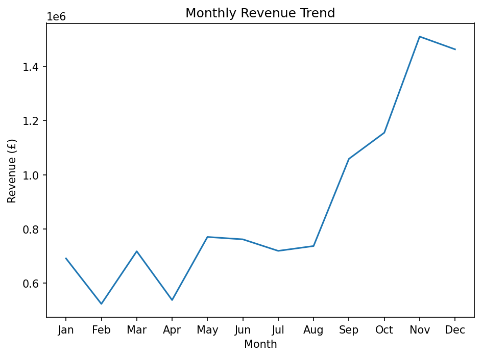
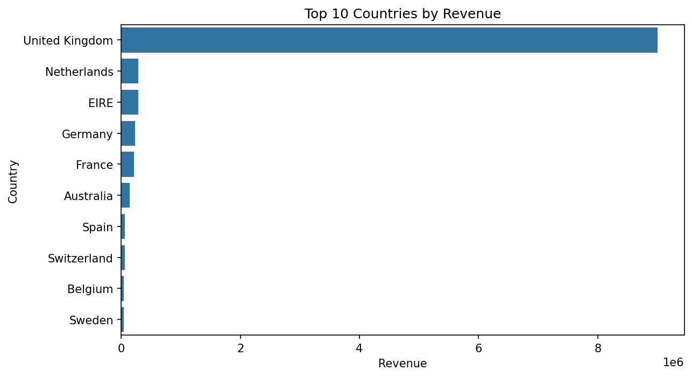
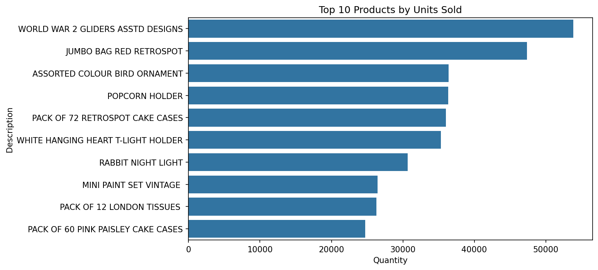

# E-Commerce Sales Analysis & Prediction

Analysis of 541,909 transactions from a UK-based online retailer to uncover sales, customer and product trends, with a logistic regression model that predicts repeat buyers at 85% accuracy.

## Problem Statement
Which countries, products and customers drive revenue for an online retailer, how does demand change across the year, and can a customer's total spend predict whether they will buy again?

## Dataset
- Source: [Kaggle - E-Commerce Data](https://www.kaggle.com/datasets/carrie1/ecommerce-data) (transactions from a UK-based online retailer)
- Size: 541,909 rows, 8 columns
- Key fields: InvoiceNo, StockCode, Description, Quantity, InvoiceDate, UnitPrice, CustomerID, Country

## Tools Used
Python, pandas, Matplotlib, Seaborn, scikit-learn, Jupyter Notebook

## Approach
1. **Data cleaning:**
   - Loaded the file with `latin1` encoding (it is not UTF-8).
   - Found 135,080 rows with no CustomerID (kept for revenue analysis, dropped for customer analysis, leaving 397,924 rows and 4,339 customers) and 1,454 rows with no product description.
   - Identified negative quantities as returns/cancellations and separated them from sales (`Quantity > 0` for sales analysis).
   - Created a `Revenue` column (`Quantity x UnitPrice`) and flagged `DOTCOM POSTAGE` as a shipping charge rather than a product.
   - Found that two products topped the sales-only quantity ranking because of very large orders that were later cancelled, so products are ranked by net units (sales minus returns) instead.
2. **Exploratory analysis:** revenue and transaction volume by country, monthly revenue trend, top products by revenue and by net units sold (after returns), and top customers by total spend.
3. **Modeling:** Logistic Regression to predict whether a customer is a repeat buyer (more than one unique invoice), using total customer revenue as the feature, with an 80/20 train/test split. Evaluated with precision, recall and F1. An earlier version that also used order count scored 100% because that feature defines the label (data leakage), so it was removed.

## Key Findings
- **The UK dominates:** £9.0M of £10.64M gross sales revenue (84.6%) comes from the UK.
- **The Netherlands is a high-value market:** £285K in revenue (second-largest country after the UK) but only 6th by number of transactions. Germany is the opposite: 2nd by transactions (9,042) but 4th by revenue.
- **Strong seasonality:** monthly revenue sits at roughly £0.5M-£0.8M from January to August, then climbs to £1.06M in September, £1.15M in October and peaks at £1.51M in November. February and April are the weakest months (£0.52M and £0.54M).
- **Revenue is concentrated in a few customers:** the top three customers (IDs 14646, 18102, 17450) generate 6.9% of total revenue, and the largest alone spent £280K.
- **Repeat buying is common:** 65.6% of identified customers (2,845 of 4,339) ordered more than once; 1,494 bought only once.
- **Top product by revenue:** Regency Cakestand 3 Tier has the highest gross revenue (£174K) once `DOTCOM POSTAGE` (£206K, a shipping charge) is excluded.
- **Best-selling products by volume:** after netting out returns, World War 2 Gliders Asstd Designs leads with about 54K units, followed by Jumbo Bag Red Retrospot (about 47K). Two products that looked like the top sellers before this adjustment dropped out of the top 10 because their huge orders were cancelled.

## Model Results
- Accuracy: 85% on 868 held-out customers (baseline of always predicting "repeat buyer": 66%)
- Repeat buyers (class 1): precision 0.90, recall 0.87, F1 0.89
- One-time buyers (class 0): precision 0.76, recall 0.81, F1 0.79

### Limitations and next steps
- Total revenue is calculated over the whole period, so it already includes spend from repeat orders. A stronger version would predict from first-purchase information only, using a time-based split with recency, frequency and monetary features.
- Revenue figures are gross sales (positive quantities only) and exclude returns, so net revenue is lower.
- Next: try Random Forest and repeat the analysis in SQL.

## Visuals




## How to Run
```
pip install pandas matplotlib seaborn scikit-learn jupyter
jupyter notebook ecommerce_analysis.ipynb
```
Download `data.csv` from the Kaggle link above, place it in the project folder, and read it with `pd.read_csv("data.csv", encoding="latin1")`.

## Author
Shaheer Samad Waien | [LinkedIn](https://linkedin.com/in/shaheer-waien) | shaheerwaien@hotmail.com
